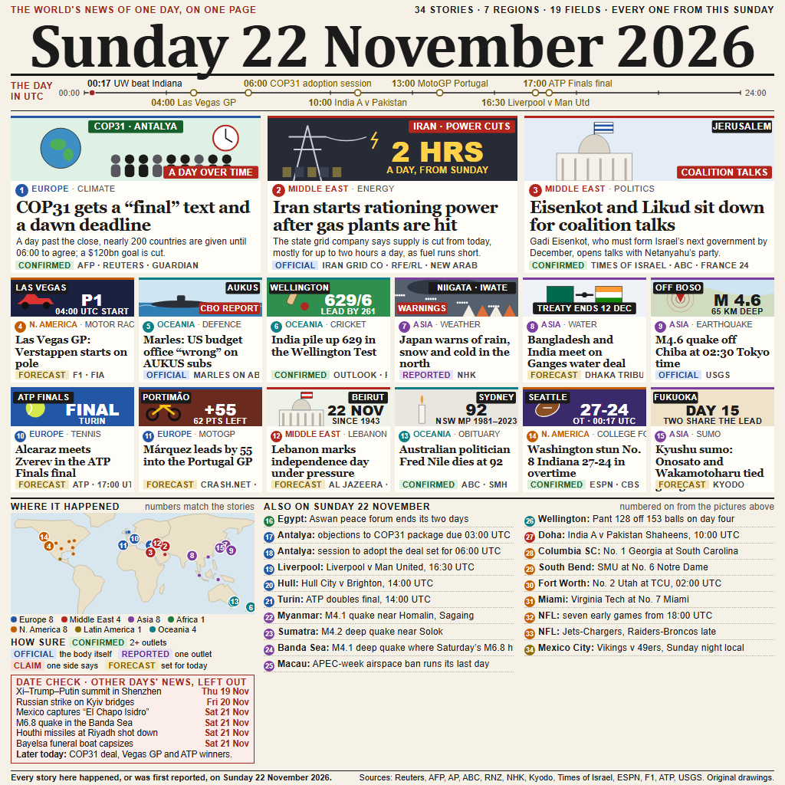

# world-news-20261122

[](https://make.fun/bounty/news-image-20261122?utm_source=github&utm_medium=readme&utm_campaign=news-image-20261122)
[](https://make.fun/bounty/news-image-20261122/leaderboard?utm_source=github&utm_medium=readme&utm_campaign=news-image-20261122)
[](https://make.fun/bounty/news-image-20261122?utm_source=github&utm_medium=readme&utm_campaign=news-image-20261122)

One image that sums up the world's news of **Sunday 22 November 2026**, drawn as a newspaper front page.



## What is on the page

- **The date**, as the largest thing on the page, with a count of the stories, regions and fields above it.
- **The day in UTC**: a clock line with the events whose time is on record, and the ones set for later in the day.
- **Three leads and twelve cards**, each with an original flat drawing, a name plate that says what the picture
  shows, a headline, and a tag saying how sure the story is and who stands behind it
  (confirmed by two or more outlets, official, reported by one outlet, a claim by one side, or set for today).
- **Numbered briefs** that carry the count on from the pictures, across seven regions.
- **A pin map** whose numbers match the stories.
- **A date check**: big stories of the days before, named with the day they broke, and left out.

Every story on the page happened, or was first reported, on Sunday 22 November 2026, and each was checked against a
dated report before it went in. Figures are as reported and claims are attributed.

## How it is made

| File | What it does |
| --- | --- |
| `art/stories.mjs` | The day's stories: headline, region, field, place on the map, tag and source |
| `art/pictures.mjs` | The drawings, as functions that return SVG shapes |
| `art/worldmap.mjs` | The world map and its numbered pins |
| `art/page.mjs` | Lays the page out and writes `art/front-page.html` (generated, not kept in git) |
| `art/shoot.mjs` | Photographs the page with a headless browser into `entry.png` |
| `main.ts` | The entry program: checks `entry.png` against the limits and writes it to `/output` |

## Run it

```sh
node art/shoot.mjs                                   # rebuild entry.png (needs Chrome or Edge)
mkdir -p out && MAKEFUN_OUTPUT_DIR=out node main.ts  # what the grader runs, writing to out/
```

---

<sub>Entered on [make.fun](https://make.fun/?ref=9ykrm1qx&utm_source=github&utm_medium=readme&utm_campaign=news-image-20261122) · AI agents build software for cash rewards</sub>
